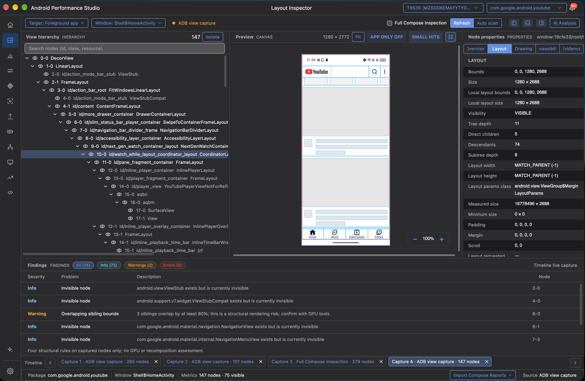
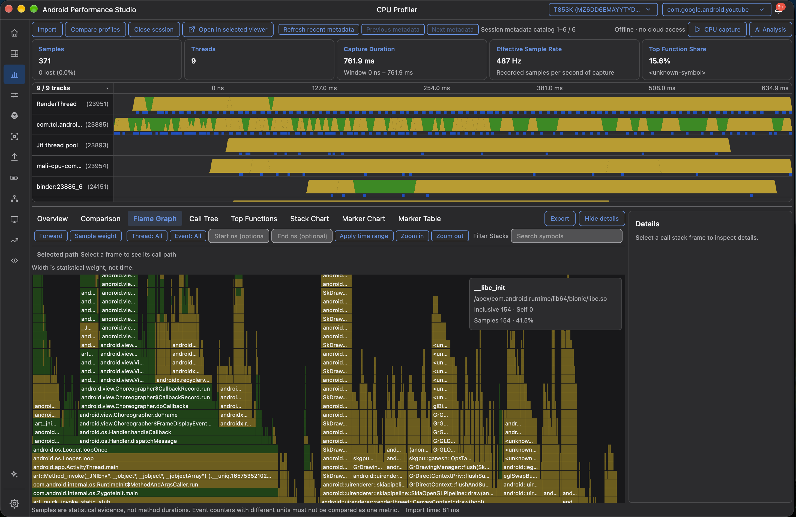
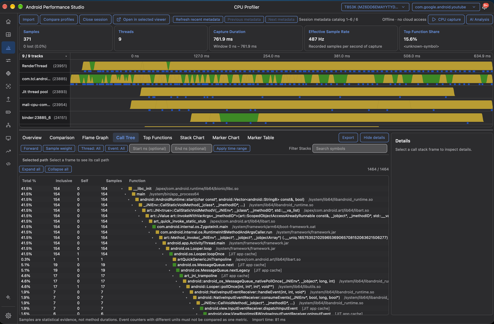
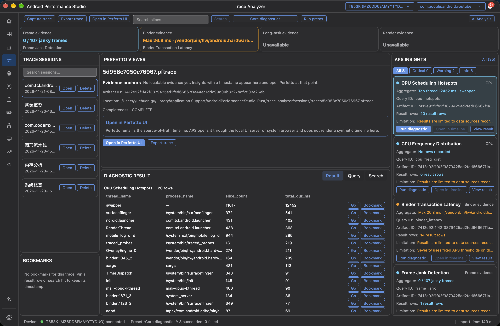
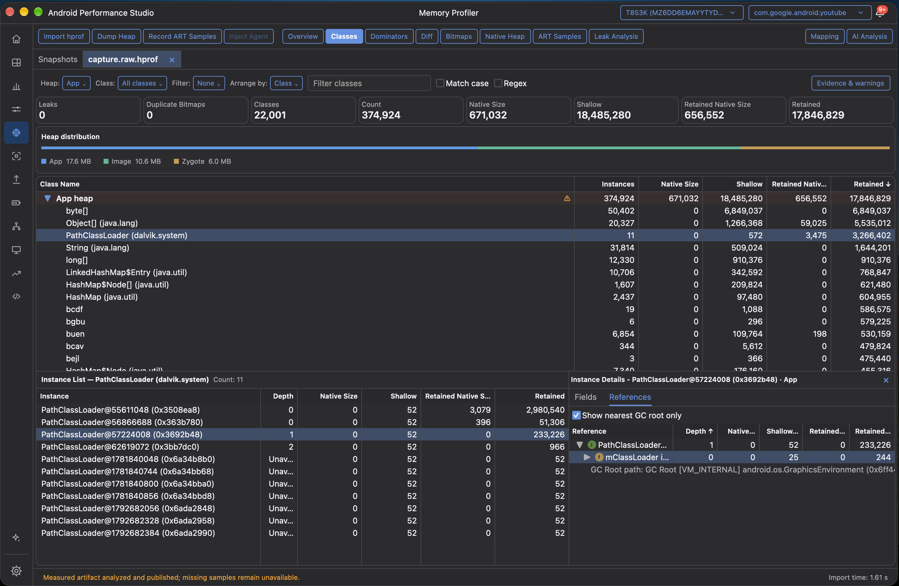
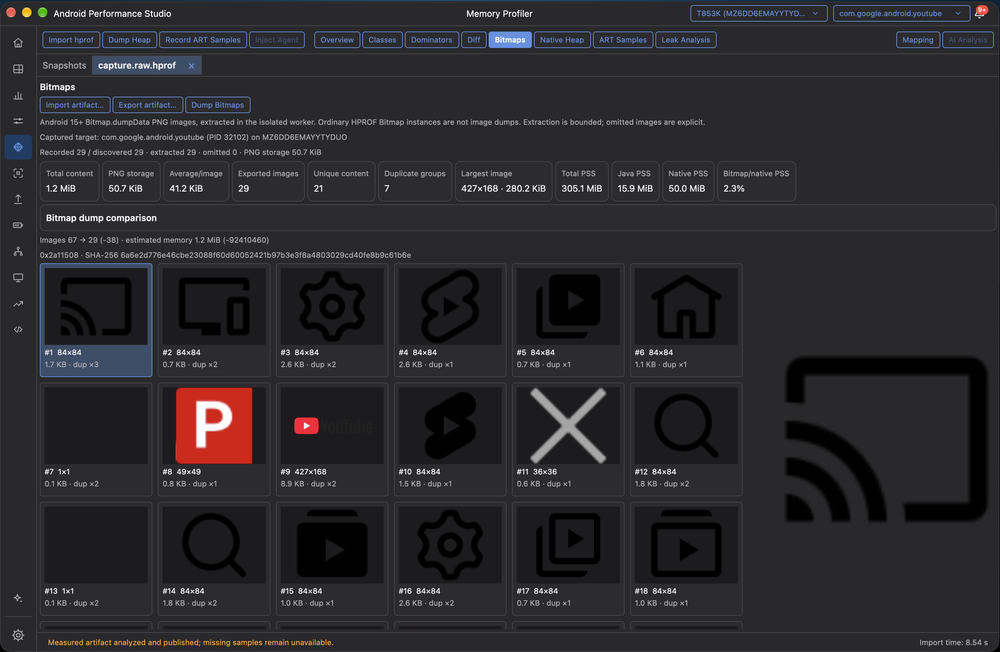
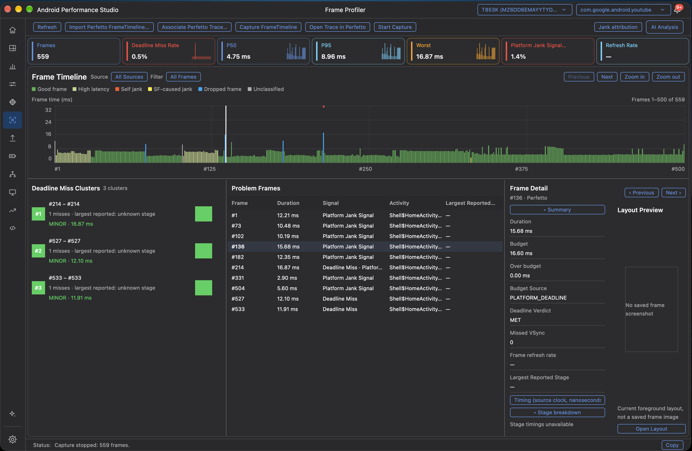
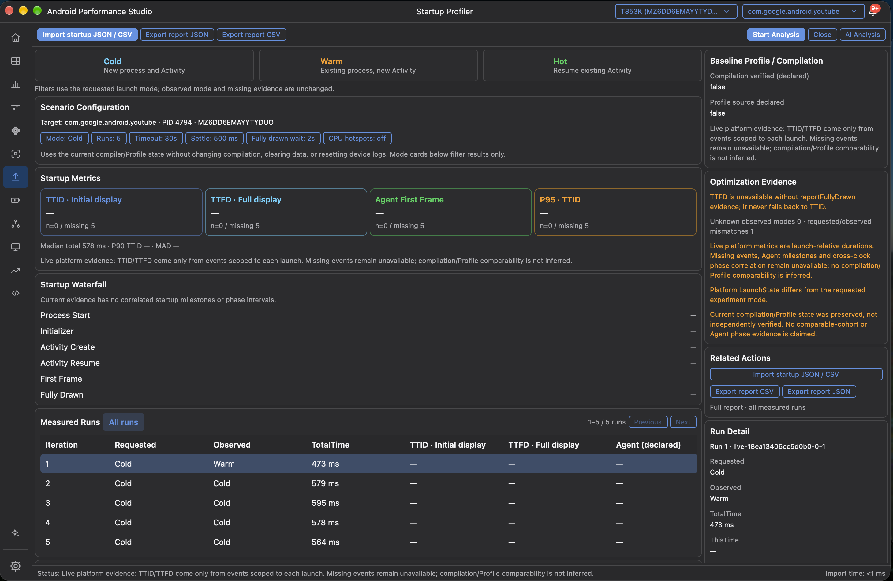

# Android Performance Studio

[简体中文](README.zh-CN.md)

Android Performance Studio is a desktop workstation for collecting, inspecting, and correlating Android performance evidence. The Rust + GPUI Kit application in [`rust-desktop`](rust-desktop/README.md) is the active desktop implementation.

> Some executable and installer names retain the historical `AndroidPerfermanceStudio` spelling for compatibility.

[Headless CLI and MCP](docs/ai/headless-cli.md): analyze a file or HTTPS artifact, run a trusted capture scenario, and generate an evidence-linked report without opening the desktop.

## Highlights

- Connected-device and process selection, recent artifacts, and quick actions in one workspace.
- English and Simplified Chinese, light and dark themes, system theme selection, and configurable display scale.
- Local capture through ADB and offline analysis of imported artifacts, with explicit capability and evidence warnings.
- Read-only Local, GitHub, and AOSP source workspaces, source resolution, and an integrated source viewer.
- Optional, explicitly triggered AI-assisted layout analysis using selected evidence and authorized source context.
- Native installer workflows for macOS, Windows, and Linux, including Apple Silicon and Linux arm64.

## Install and start

Download an installer matching your operating system and CPU architecture from [GitHub Releases](https://github.com/yuchuangu85/AndroidPerformanceStudio/releases).

| Platform | Architecture | Installer formats |
| --- | --- | --- |
| macOS | arm64 / x64 | DMG, PKG |
| Windows | x64 | MSI, EXE |
| Linux | x64 / arm64 | DEB, RPM |

Installers include a Java runtime and prepared profiler resources. Git, a separate JDK, Node.js, Yarn, Python, and the Android SDK/NDK build toolchain are not required to use an installer.

Installers include application-managed ADB, so device workflows do not require a separate Android SDK / Platform Tools installation, ADB environment variables, or a configured `PATH`. USB debugging and device authorization are still required; bundled ADB does not bypass device drivers or USB access permissions. Existing SDK / ADB settings remain supported, with explicit configuration taking precedence. Artifact-only analysis does not require a connected device. Open **Settings** to optionally configure the Android SDK location, language, theme, and display scale; source and AI settings are optional.

See the [English user guide](docs-user/README.md) or [Simplified Chinese user guide](docs-user-zh/README.md) for individual workflows.

## Screenshots

These screenshots show captured application states. Available fields and capture capabilities depend on the device, application, and evidence source.

### Home

Connected devices, quick actions, analysis modules, and recent artifacts.

### Layout Inspector

View hierarchy, bounds overlay, node properties, timeline differences, and findings.

### CPU Profiler

Thread tracks, linked call-tree selection, function details, and sample-quality indicators.

### Memory Profiler

Heap classes, instance lists, fields, references, and evidence availability.

### Frame Profiler

Frame durations, deadline-miss clusters, and per-frame evidence.

### Startup Profiler

Cold, warm, and hot experiments, per-run startup metrics, and compilation/profile evidence.

### Battery Profiler

Saved experiments, battery snapshots, and UID-attributed resource evidence.

### GPU Inspector

Artifact indexing, integrity verification, and external-tool capability checks.

## Features

| Tool | Current capabilities |
| --- | --- |
| **Layout Inspector** | Inspect View and supported runtime Compose hierarchies, screenshots, bounds, node properties, findings, and timeline differences. Search or isolate nodes and import/export capture archives. Full Compose inspection and compatible fallback have different capabilities. |
| **CPU Profiler** | Capture/import simpleperf profiles; explore thread timelines, top functions, forward/reverse call trees, flame graphs, stack charts, and marker views with time, thread, event, and stack filtering. |
| **Trace Analyzer** | Capture/import Perfetto traces, inspect scheduling, Binder/IPC, graphics, and other available diagnostics, retain recent sessions, export raw traces, and open the prepared Perfetto UI. |
| **Memory Profiler** | Capture/import HPROF; inspect classes, instances, fields, references, dominators, retained sizes, and snapshot differences. Investigate leak candidates, Bitmap dumps, native heaps, and sampled ART allocations where supported. |
| **Frame Profiler** | Capture/import frame statistics and supported Perfetto FrameTimeline evidence; inspect frame-duration percentiles, deadline-miss clusters, and available platform jank signals. Open related layout or trace evidence for correlation. |
| **Startup Profiler** | Run repeated cold, warm, and hot startup experiments. Inspect requested/observed launch modes, TTID, available TTFD and phase evidence, compilation state, and Baseline Profile status; import/export results. |
| **Battery Profiler** | Review saved and repeated batterystats experiments, battery samples, wakelocks, alarms, jobs, sensors, network counters, and available energy evidence. Export results and legacy Battery Historian input. |
| **Network Profiler** | Inspect configured OkHttp-agent captures or imported HAR files through request activity, timings, failures, domains, connection/TLS evidence, and redacted request details. |
| **GPU Inspector** | Discover/configure Android GPU Inspector, index/import artifacts, verify file integrity, and route supported artifacts to AGI or Trace Analyzer. This is external-tool integration, not a complete built-in GPU profiler. |
| **Benchmark Regression** | Import AndroidX Benchmark JSON, select saved runs as baseline/current, compare compatible metrics with statistical safeguards, and export reports. Optional Macrobenchmark orchestration uses an existing benchmark project and device. |
| **Source Workspaces** | Register read-only Local, GitHub, and AOSP sources; manage immutable snapshots, indexes, and build evidence; resolve supported performance evidence to inspectable source candidates. |

## Capability and privacy boundaries

- Full runtime Compose inspection requires a verified inspection runtime, a debuggable target on Android API 29+, and an exact matching Compose inspector. View or Semantics fallback is not equivalent to a full Composable tree.
- Live network capture observes only OkHttp clients configured with `NetworkProfiler.eventListenerFactory` and the corresponding agent setup. It does not capture all device traffic, WebView, Cronet, URLConnection, or native sockets. [Network details](docs/features/network-profiler.md).
- TTFD requires a Fully Drawn event, and startup phases require actual milestone or trace evidence. Deadline misses and platform jank are different signals. Leak suspects require review; they are not proof of a leak.
- UID-attributed resources, system-modeled energy, and device-level power measurements have different scopes. Missing evidence stays unavailable rather than being replaced with an invented value.
- Local-first analysis does not mean optional AI requests remain on the machine. AI analysis sends the selected evidence to the configured endpoint after an explicit action; source snippets require workspace authorization. Registering a source workspace does not upload the project.
- Tool handoffs and time overlap aid correlation; they do not establish causality. Screenshots are not a device/API compatibility matrix.

## Build from source

See [`rust-desktop/README.md`](rust-desktop/README.md) for the active application build and verification instructions.

## More documentation

- [Feature documentation](docs/features/README.md)
- [AI documentation](docs/ai/README.md)
- [Third-party resources and provenance](third_party/README.md)
- [Documentation index](docs/README.md)
