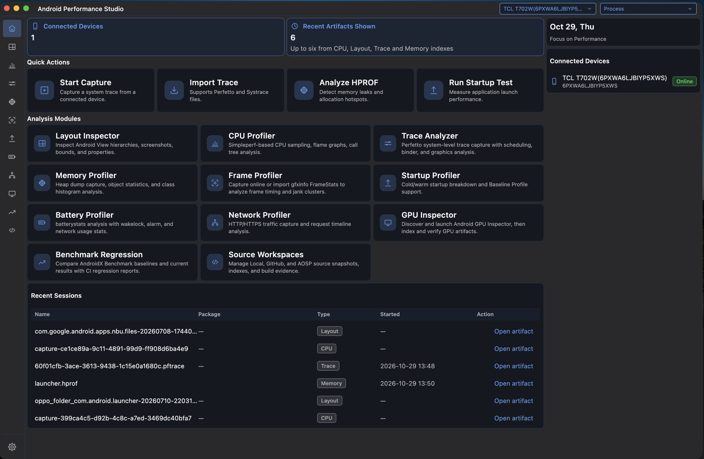
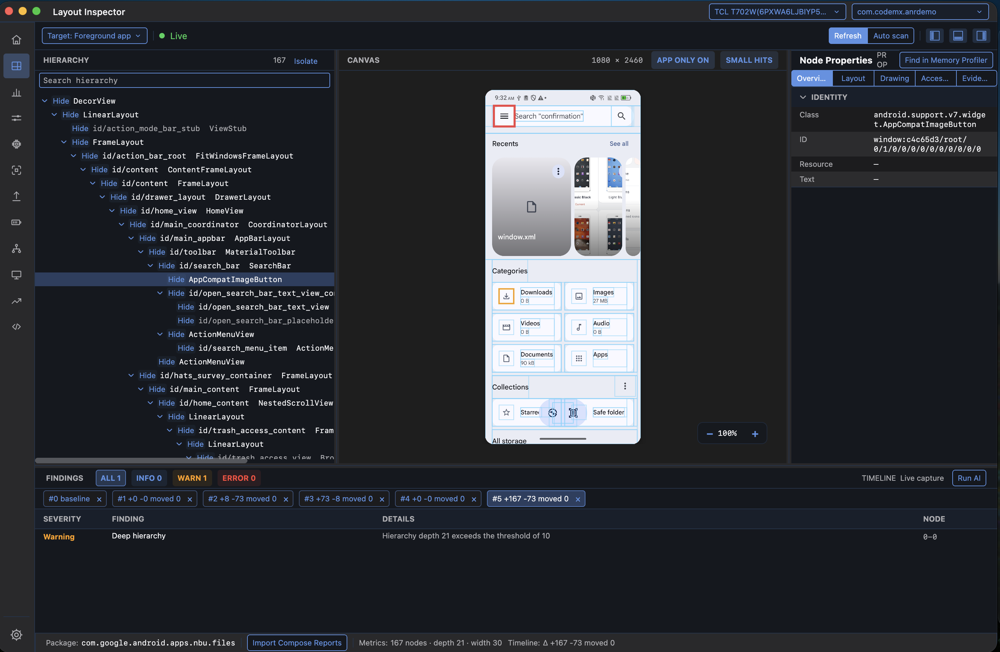
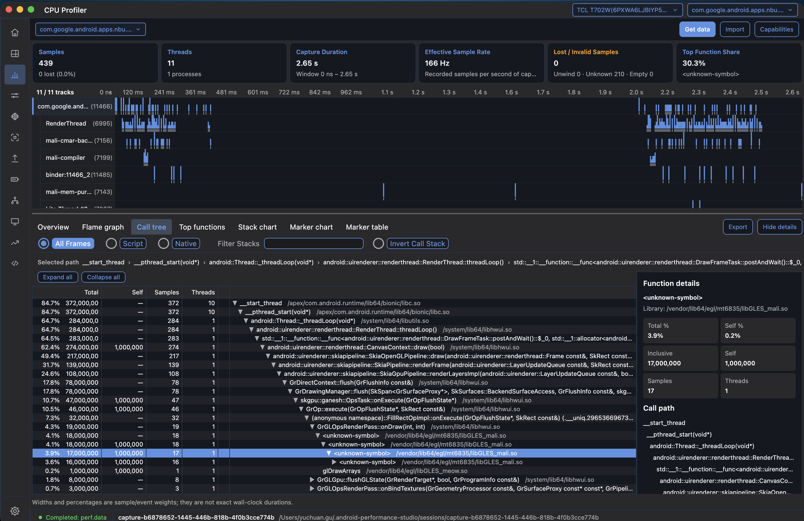
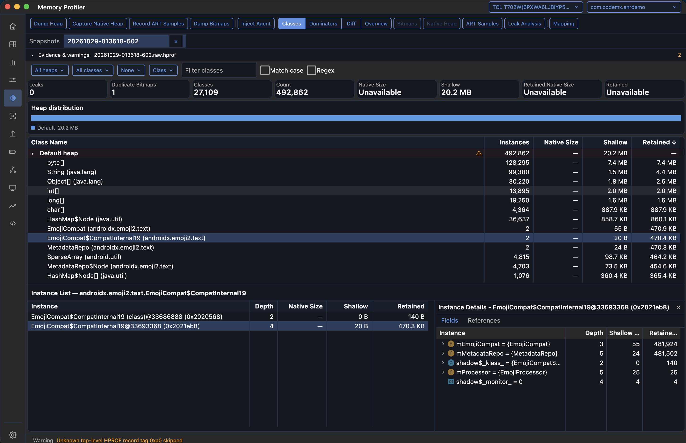
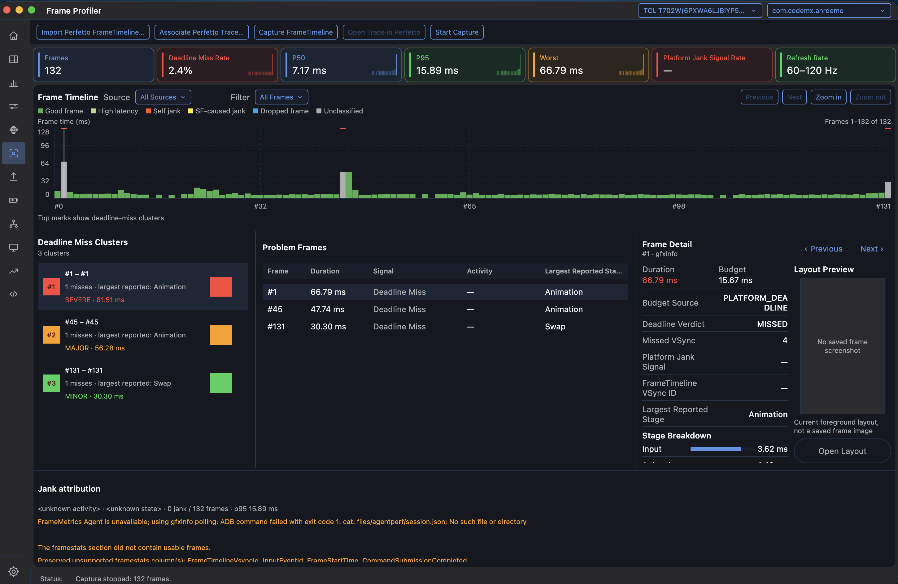
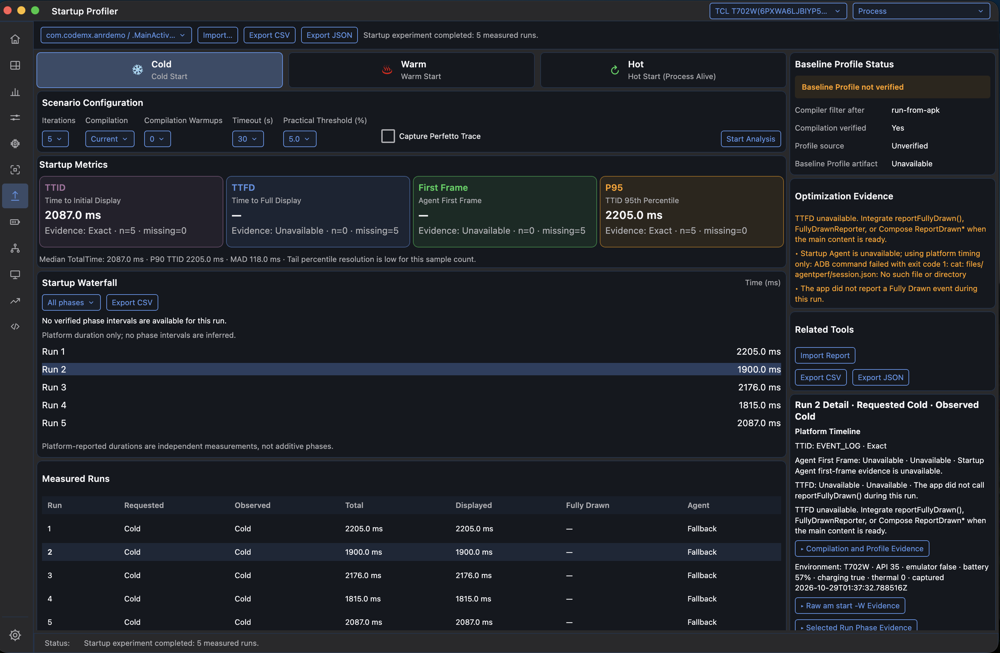
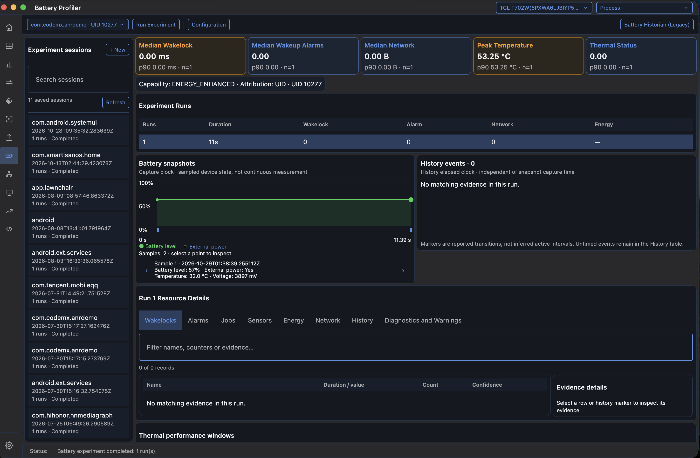
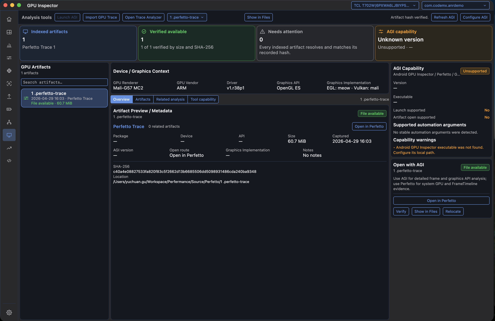

# Android Performance Studio

[English](README.md)

Android Performance Studio 是一个基于 Compose Desktop 的 Android 性能分析工作台，用于采集、查看和关联性能证据。布局、CPU、系统 Trace、内存、帧耗时、启动、电量、网络、GPU 工具和基准回归分析共用一个桌面应用，同时保持各分析器的数据模型与实现边界。

> 部分可执行文件和安装包文件名沿用历史拼写 `AndroidPerfermanceStudio`，以保持兼容。

## 特性概览

- 统一的设备与进程选择、最近分析产物、快捷操作和功能导航。
- 支持英文、简体中文、浅色、深色、跟随系统主题及显示缩放设置。
- 通过 ADB 在线采集，也可离线分析导入的产物；明确展示能力限制、证据缺失和降级原因。
- 只读的 Local、GitHub 和 AOSP 源码工作区，提供源码快照、定位候选与内置源码查看器。
- 可选、显式触发的 AI 辅助布局分析，使用选中的性能证据和经授权的源码上下文。
- 覆盖 macOS、Windows、Linux 的原生安装包工作流，包括 Apple Silicon 和 Linux arm64。

## 安装与开始使用

从 [GitHub Releases](https://github.com/yuchuangu85/AndroidPerformanceStudio/releases) 下载与操作系统、CPU 架构匹配的安装包。

| 平台 | 架构 | 安装包格式 |
| --- | --- | --- |
| macOS | arm64 / x64 | DMG、PKG |
| Windows | x64 | MSI、EXE |
| Linux | x64 / arm64 | DEB、RPM |

安装包已包含 Java 运行时和准备好的分析器资源。使用安装包不需要 Git、独立 JDK、Node.js、Yarn、Python 或 Android SDK/NDK 构建工具链。

设备采集需要 Android SDK Platform Tools（`adb`）、开启 USB 调试并授权设备。仅分析导入产物时不需要连接设备。打开 **Settings** 可配置 Android SDK 位置、语言、主题和显示缩放；源码与 AI 设置按需配置。

具体操作见[中文用户指南](docs-user-zh/README.md)或[英文用户指南](docs-user/README.md)。

## 界面截图

以下图片展示实际采集或查看时的应用状态；字段是否可用、采集能力是否具备，取决于设备、目标应用和证据来源。

### 主页

连接设备、快捷操作、分析模块和最近分析产物。



### Layout Inspector

View 层级、边界叠加、节点属性、时间线差异与问题提示。



### CPU Profiler

线程轨道、调用树联动选择、函数详情和采样质量指标。



### Memory Profiler

堆中的类、实例列表、字段、引用和证据可用状态。



### Frame Profiler

帧耗时、截止时间未命中聚类和单帧证据。



### Startup Profiler

冷启动、温启动、热启动实验，逐轮指标和编译、Profile 证据。



### Battery Profiler

已保存实验、电池快照和 UID 归因的资源证据。



### GPU Inspector

产物索引、完整性校验和外部工具能力检查。



## 功能说明

| 工具 | 当前能力 |
| --- | --- |
| **Layout Inspector** | 检查 View 和受支持的运行时 Compose 层级、截图、边界、节点属性、问题提示与时间线差异；支持节点搜索、隔离和采集归档导入/导出。完整 Compose 检查与兼容回退具有不同的能力边界。 |
| **CPU Profiler** | 采集或导入 simpleperf 数据，结合线程时间线、热点函数、正向/反向调用树、火焰图、Stack Chart 和 Marker 视图，按时间、线程、事件及调用栈条件分析。 |
| **Trace Analyzer** | 采集或导入 Perfetto Trace，分析调度、Binder/IPC、图形及其他可用诊断数据；保留最近会话、导出原始 Trace，并可打开准备好的 Perfetto UI。 |
| **Memory Profiler** | 采集或导入 HPROF，检查类、实例、字段、引用、支配树、保留大小和快照差异；按采集路径能力分析泄漏候选、Bitmap 转储、Native Heap 与 ART 分配采样。 |
| **Frame Profiler** | 采集或导入帧统计及受支持的 Perfetto FrameTimeline 证据，查看帧耗时分位数、截止时间未命中聚类和可用的平台 Jank 信号；关联查看布局或 Trace 证据。 |
| **Startup Profiler** | 重复执行 Cold、Warm、Hot 启动实验，检查请求与观测模式、TTID、可用的 TTFD 和阶段证据、编译状态及 Baseline Profile 状态；支持结果导入/导出。 |
| **Battery Profiler** | 查看已保存或多轮的 batterystats 实验、电池采样、Wakelock、Alarm、Job、Sensor、网络计数器与可用的能量证据；导出结果及传统 Battery Historian 输入。 |
| **Network Profiler** | 分析已配置的 OkHttp Agent 采集或导入的 HAR，通过请求活动、阶段耗时、失败、域名、连接/TLS 证据和脱敏后的请求详情排查问题。 |
| **GPU Inspector** | 发现和配置 Android GPU Inspector，导入或索引产物、校验文件完整性，并将支持的产物交给 AGI 或 Trace Analyzer；它是外部工具集成，不是完整的内置 GPU Profiler。 |
| **Benchmark Regression** | 导入 AndroidX Benchmark JSON，选择已保存结果作为基线和当前版本，在可比性与统计约束下比较指标并导出报告；可选的 Macrobenchmark 编排使用已有测试工程和设备。 |
| **Source Workspaces** | 注册只读的 Local、GitHub、AOSP 源码，管理不可变快照、索引和构建证据，将受支持的性能证据解析为可检查的源码定位候选。 |

## 能力与隐私边界

- 完整运行时 Compose 检查需要经过校验的检查运行时、Android API 29+ 上的可调试进程，以及精确匹配的 Compose Inspector。View 或 Semantics 回退不等同于完整 Composable 树。
- 在线网络采集仅覆盖配置了 `NetworkProfiler.eventListenerFactory` 并完成相应 Agent 设置的 OkHttp 客户端，不是整机抓包，也不覆盖 WebView、Cronet、URLConnection 或 Native Socket。见[网络采集说明](docs/features/network-profiler.md)。
- TTFD 需要 Fully Drawn 事件，启动阶段需要实际的里程碑或 Trace 证据；截止时间未命中与平台 Jank 是不同信号；疑似泄漏需要复核，不能直接等同于已确认泄漏。
- UID 资源归因、系统模型估算能量和整机功耗实测的范围不同。证据缺失时保持不可用，不填充虚构数值。
- 本地优先不代表可选 AI 请求始终留在本机。AI 分析经显式操作向配置的端点发送选中证据；源码片段还需要工作区授权。注册源码工作区不意味着上传整个工程。
- 跨工具跳转和时间重叠用于关联排查，不自动证明因果；截图也不代表设备或 API 兼容性矩阵。
- 大规模、深栈、碎片化 Stack Chart 数据已有[性能优化方案](desktop-viewer/simpleperf-viewer/docs/design/2026-10-29-stack-chart-performance-optimization-plan.md)，该方案目前仍标记为 **未实现**。

## 从源码构建

### 前置条件

- JDK 21 和 Git。
- 构建固定版本 Firefox Profiler 资源需要 Node.js **24** 与 Yarn Classic **1.x**。
- 资源准备需要 Python 3、`curl` 和 `unzip`；发布 CI 使用 Python 3.13。
- 检查运行时的构建主机需要 Android SDK 命令行工具、SDK Platform Tools、NDK/CMake 和 `patch`。
- 以下脚本示例使用兼容 Bash 的 Shell；Windows 的 Gradle 任务使用 `gradlew.bat`。

构建工具版本以 [Gradle Wrapper](desktop-viewer/gradle/wrapper/gradle-wrapper.properties)、[版本目录](desktop-viewer/gradle/libs.versions.toml)和[发布工作流](.github/workflows/release.yml)为准。

### 1. 克隆并准备分析器资源

```bash
git clone --recurse-submodules https://github.com/yuchuangu85/AndroidPerformanceStudio.git
cd AndroidPerformanceStudio

npm install --global yarn@1
./scripts/firefox-profiler.sh all
./scripts/build-perfetto-ui.sh download
PERFETTO_TOOLS_DIR="$PWD/build/perfetto-tools" ./scripts/install-trace-processor.sh
```

已有工程若未拉取子模块，先运行 `git submodule update --init --depth 1 --recursive`。Perfetto 的 `download` 模式会准备包含 WASM 资源的完整固定版本 UI 分发包。

### 2. 准备经过校验的 Compose 检查运行时

桌面资源准备阶段会在运行或打包前检查该 Bundle。在已配置的 Unix 构建主机上，将 `ANDROID_HOME` 指向预期的 SDK，并安装发布 CI 使用的工具：

```bash
sdkmanager --sdk_root="${ANDROID_HOME:?Set ANDROID_HOME to your Android SDK}" --install \
  "platforms;android-35" "build-tools;35.0.0" \
  "ndk;27.1.12297006" "cmake;3.22.1"

./desktop-viewer/gradlew -p desktop-viewer \
  :layout-inspector:compose-agent-build:verifyComposeAgentBundle \
  --no-configuration-cache --no-daemon
```

这些 SDK 版本用于构建与桌面主机无关的检查运行时，不是可选 Android 示例应用的工具链要求。发布 CI 在 Linux x64 上构建一次 Bundle，再供所有打包任务使用。打包主机也可使用已构建的 `desktop-viewer/layout-inspector/compose-agent-build/build/compose-agent-bundle/`，使用前会检查 manifest、包含 dex 的 JAR 和设备 ABI 产物。详见[运行时构建说明](desktop-viewer/layout-inspector/compose-inspection-host/AGENT_BUNDLE.md)。

### 3. 运行

```bash
./desktop-viewer/gradlew -p desktop-viewer :desktop-app:run
```

## 测试与打包

桌面应用测试与功能模块测试分开执行；各功能模块是独立的 included build，有各自的测试任务：

```bash
./desktop-viewer/gradlew -p desktop-viewer :desktop-app:test --no-daemon

# 功能模块验证示例
./desktop-viewer/gradlew -p desktop-viewer \
  :layout-inspector:presentation:test \
  :simpleperf-viewer:profile-analysis:test --no-daemon
```

完成上述资源准备后，为当前主机生成应用镜像：

```bash
./desktop-viewer/gradlew -p desktop-viewer :desktop-app:createDistributable --no-daemon
```

应用镜像不等同于安装包。安装包应在匹配的操作系统上，使用对应架构的 JDK 构建；Linux 安装包构建还需要 `fakeroot` 和 `rpm`：

```bash
# macOS Apple Silicon / Intel：在匹配主机上选择 arm64 或 x64
./desktop-viewer/gradlew -p desktop-viewer :desktop-app:packageDmg :desktop-app:packagePkg -Ptarget.arch=arm64 --no-daemon

# Windows x64
./desktop-viewer/gradlew.bat -p desktop-viewer :desktop-app:packageMsi :desktop-app:packageExe -Ptarget.arch=x64 --no-daemon

# Linux x64 / arm64：选择匹配架构
./desktop-viewer/gradlew -p desktop-viewer :desktop-app:packageDeb :desktop-app:packageRpm -Ptarget.arch=x64 --no-daemon
./desktop-viewer/gradlew -p desktop-viewer :desktop-app:packageDeb :desktop-app:packageRpm -Ptarget.arch=arm64 --no-daemon
```

主应用版本统一定义在 [desktop-viewer/build.gradle.kts](desktop-viewer/build.gradle.kts)，可通过 `-PappVersion=0.7.1` 覆盖。指定打包 JDK 时可使用 `-Ptarget.javaHome=/JDK/绝对路径`。

发布工作流支持版本标签或手动输入版本号：先运行测试、准备检查运行时、构建平台矩阵中的十个安装包，再核对上传产物后发布。签名和公证是独立的发布要求，当前工作流未配置这些步骤。

## 项目结构

```text
desktop-viewer/          Compose Desktop 应用与复合功能构建
  desktop-app/           应用外壳、导航、设置与原生打包
  layout-inspector/      View/Compose 检查、归档与问题提示
  simpleperf-viewer/     CPU 采样、查询与报告可视化
  perfetto-viewer/       系统 Trace 采集、诊断与查看器集成
  memory-profiler/       HPROF、实例/引用、Native Heap 与 Bitmap 分析
  frame-profiler/        帧耗时、截止时间未命中与 Jank 证据
  startup-profiler/      启动实验与编译、Profile 证据
  battery-profiler/      电量实验与 UID 资源证据
  network-profiler/      已配置的网络 Agent 采集与 HAR 分析
  gpu-inspector-integration/  AGI 发现与已校验产物跳转
  benchmark-regression/  基准比较、编排与报告
  source-workspace/      源码提供方、快照、索引与定位
  ai-core/               共享 AI 传输与证据约束契约
  platform-core/         共享 Profiler、ADB 与主机工具链契约
  platform-perfetto/     固定版本 Trace Processor 与 Perfetto 基础设施
  ui-components/         共享 Compose 控件与主题
media/                   本文使用的应用截图
third_party/             固定版本的上游代码与分析器资源
scripts/                 资源准备和构建脚本
docs-user/               英文用户指南
docs-user-zh/            简体中文用户指南
docs/                    架构、需求与功能文档
```

## 更多文档

- [功能介绍目录](docs/features/README.md)
- [桌面端开发指南](desktop-viewer/docs/architecture/DEVELOPMENT.md)
- [Layout Inspector 协议](desktop-viewer/docs/architecture/PROTOCOL.md)
- [Source Workspace](desktop-viewer/source-workspace/README.md)
- [AI Core](desktop-viewer/ai-core/README.md)
- [AI 文档目录](docs/ai/README.md)
- [第三方资源与来源说明](third_party/README.md)
- [文档索引](docs/README.md)
