# Android Performance Studio

[English](README.md)

Android Performance Studio 是一个基于 Rust + GPUI Kit 的 Android 性能分析工作台，用于采集、查看和关联性能证据。布局、CPU、系统 Trace、内存、帧耗时、启动、电量、网络、GPU 工具和基准回归分析共用一个桌面应用，同时保持各分析器的数据模型与实现边界。

> 部分可执行文件和安装包文件名沿用历史拼写 `AndroidPerfermanceStudio`，以保持兼容。

[无界面 CLI 与 MCP](docs/ai/cli/README.md)：分析本地文件或 HTTPS 工件，执行经确认的采集场景，并生成引用证据的报告。

## 特性概览

- 统一的设备与进程选择、最近分析产物、快捷操作和功能导航。
- 支持英文、简体中文、浅色、深色、跟随系统主题及显示缩放设置。
- 通过 ADB 在线采集，也可离线分析导入的产物；明确展示能力限制、证据缺失和降级原因。
- 只读的 Local、GitHub 和 AOSP 源码工作区，提供源码快照、定位候选与内置源码查看器。
- 可选、显式触发的 AI 辅助布局分析，使用选中的性能证据和经授权的源码上下文。
- 覆盖 macOS、Windows、Linux 的原生安装包工作流，包括 Apple Silicon 和 Linux arm64。

## 安装与开始使用

从 [GitHub Releases](https://github.com/yuchuangu85/AndroidPerformanceStudio/releases) 下载与操作系统、CPU 架构匹配的安装包。

| 平台 | 架构 | 安装包格式 |
| --- | --- | --- |
| macOS | arm64 / x64 | DMG、PKG |
| Windows | x64 | MSI、EXE |
| Linux | x64 / arm64 | DEB、RPM |

安装包已包含 Java 运行时和准备好的分析器资源。使用安装包不需要 Git、独立 JDK、Node.js、Yarn、Python 或 Android SDK/NDK 构建工具链。

安装包自带应用托管的 ADB；设备采集不需要另行安装 Android SDK / Platform Tools，也不需要配置 ADB 环境变量或 `PATH`。仍需开启设备 USB 调试并授权连接；设备驱动或 USB 访问权限问题不由内置 ADB 绕过。已有 SDK / ADB 配置继续受支持，显式配置优先。仅分析导入产物时不需要连接设备。打开 **Settings** 可按需配置 Android SDK 位置、语言、主题和显示缩放；源码与 AI 设置按需配置。

具体操作见[中文用户指南](docs-user-zh/README.md)或[英文用户指南](docs-user/README.md)。

## 界面截图

以下图片展示实际采集或查看时的应用状态；字段是否可用、采集能力是否具备，取决于设备、目标应用和证据来源。

### Layout Inspector

View 层级、边界叠加、节点属性、问题提示和时间线快照。

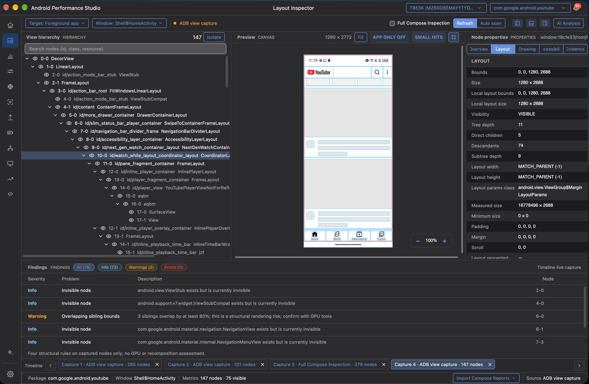

### CPU Profiler

线程轨道、按采样加权的火焰图、调用树和选中帧详情。

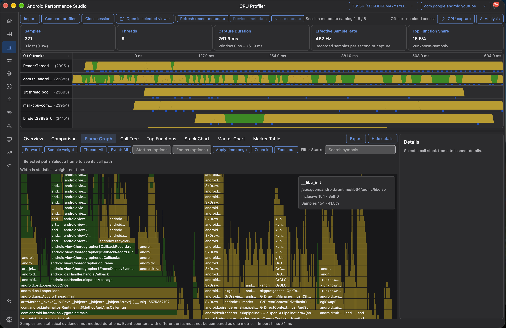

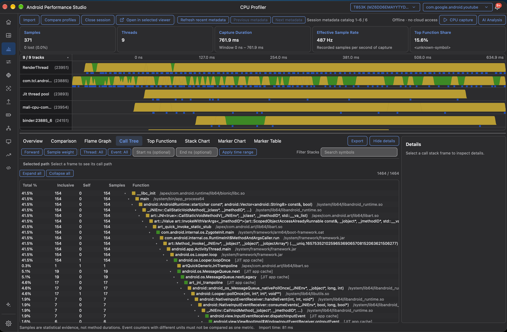

### Trace Analyzer

最近 Trace 会话、预置诊断、关联证据的洞察，以及交接 Perfetto UI。

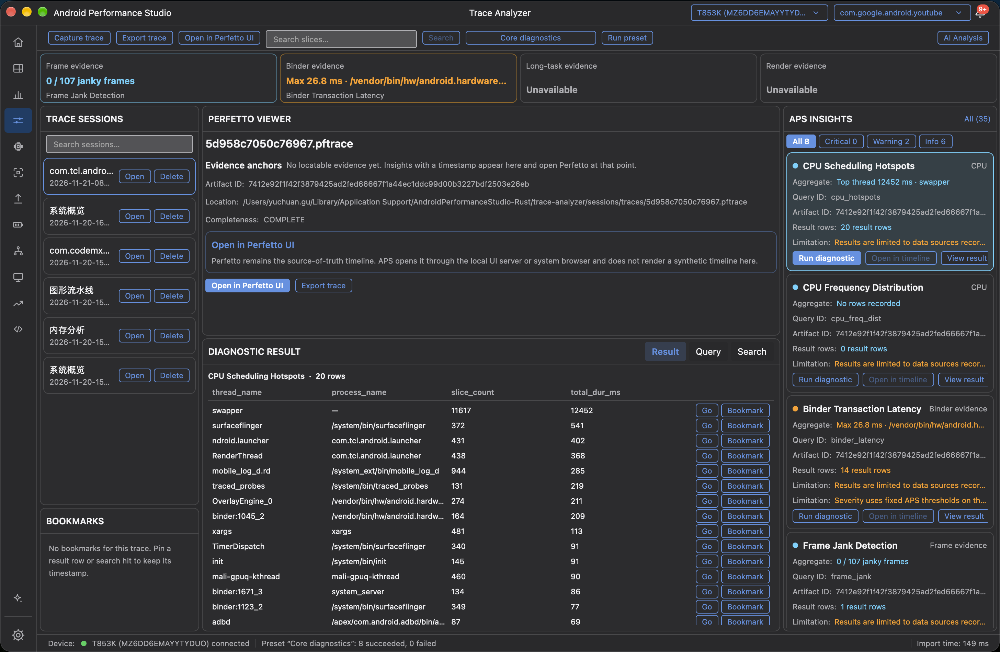

### Memory Profiler

堆分布、类与实例表格、保留大小、引用链和 Bitmap 转储。

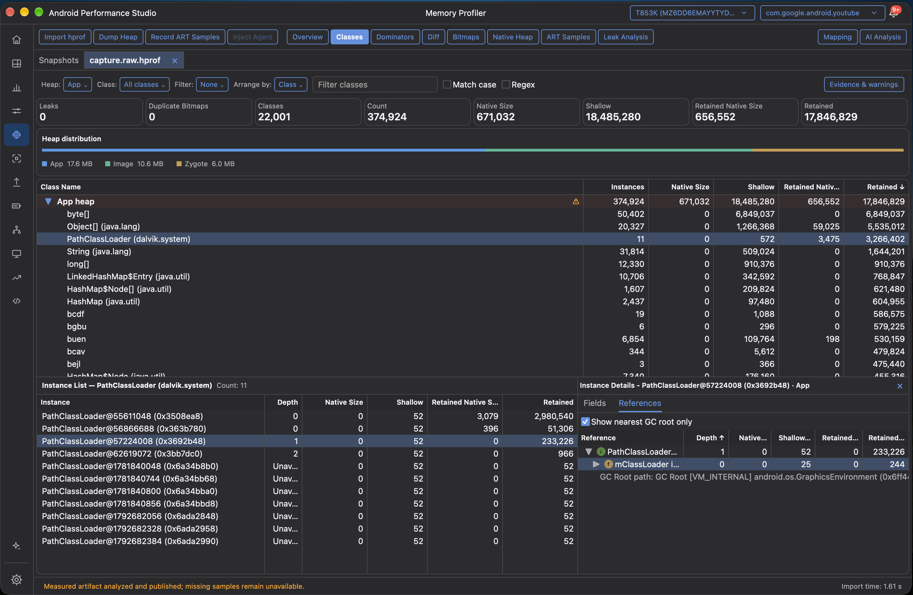

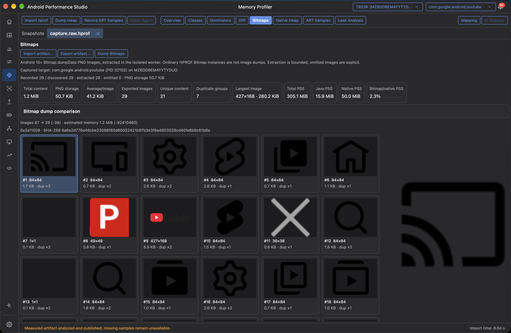

### Frame Profiler

帧时间线、截止时间未命中聚类、问题帧和单帧详情。

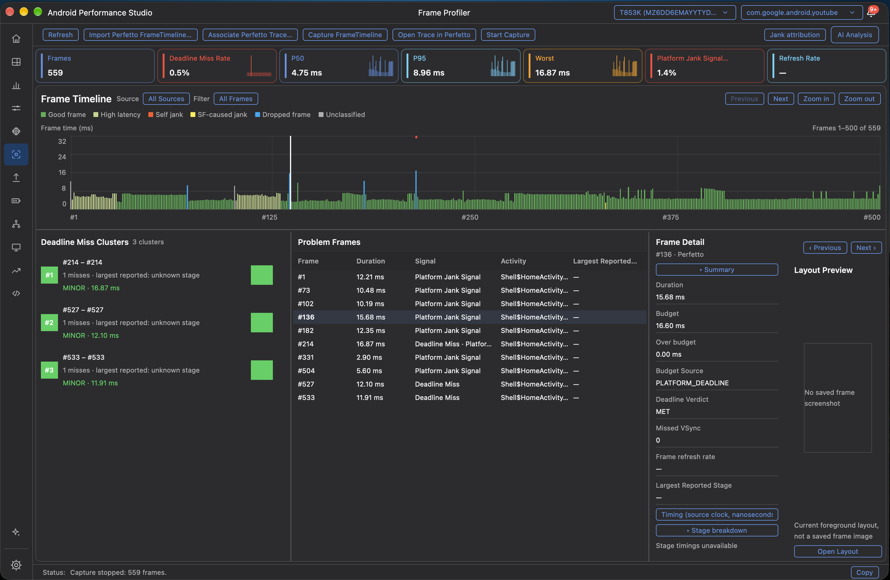

### Startup Profiler

冷、温、热启动的重复运行、启动指标、启动瀑布和编译证据。

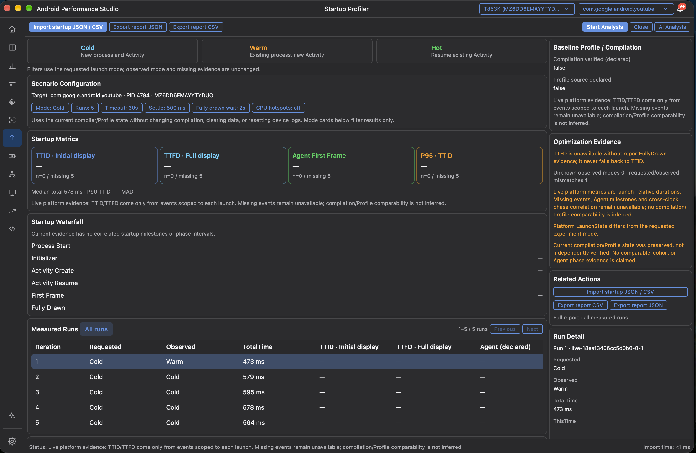

### Battery Profiler

已保存实验、UID 归因资源、基线比较和电池历史。

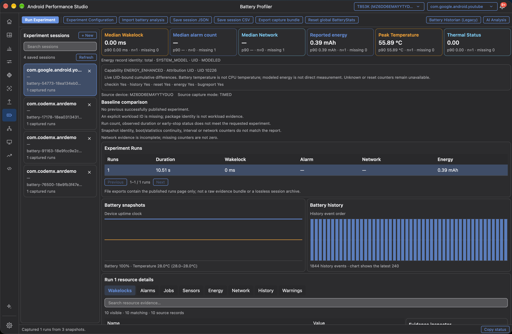

### Network Profiler

HAR 导入或在线采集、请求列表、域名和脱敏后的请求详情。

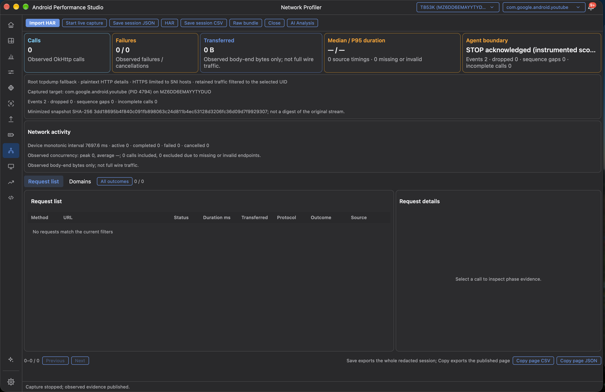

### GPU Inspector

产物索引、完整性校验、图形上下文和外部工具能力。

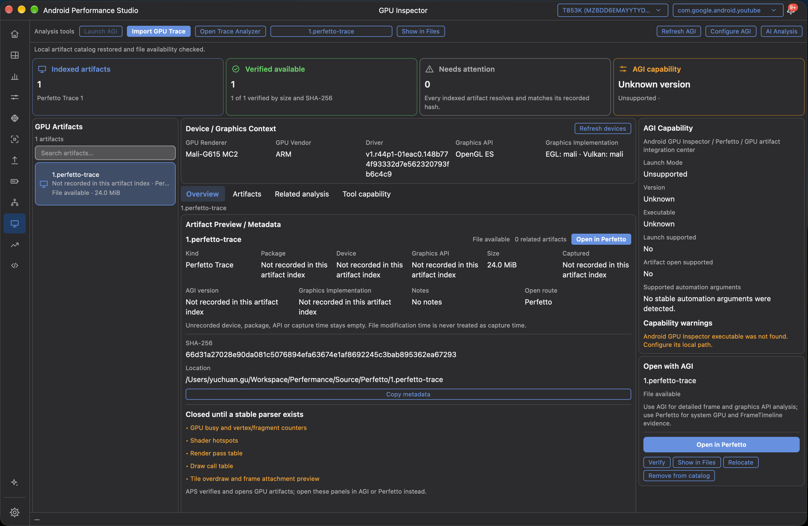

### Source Workspaces

已注册的只读工作区、索引符号搜索和源码查看器。

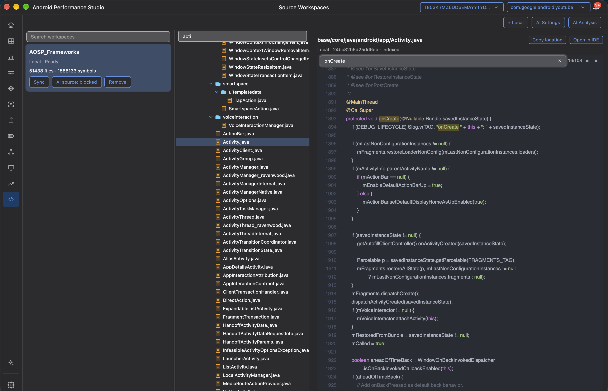

### Settings

语言、主题、显示缩放、侧边栏标签和主题色。

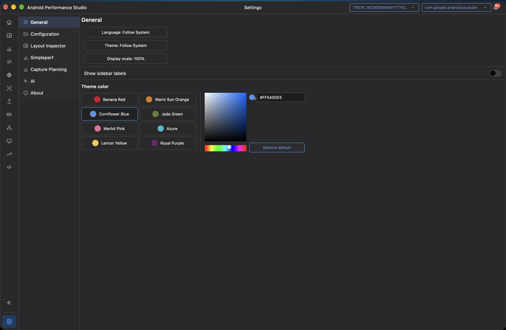

## 功能说明

| 工具 | 当前能力 |
| --- | --- |
| **Layout Inspector** | 检查 View 和受支持的运行时 Compose 层级、截图、边界、节点属性、问题提示与时间线差异；支持节点搜索、隔离和采集归档导入/导出。完整 Compose 检查与兼容回退具有不同的能力边界。 |
| **CPU Profiler** | 采集或导入 simpleperf 数据，结合线程时间线、热点函数、正向/反向调用树、火焰图、Stack Chart 和 Marker 视图，按时间、线程、事件及调用栈条件分析。 |
| **Trace Analyzer** | 采集或导入 Perfetto Trace，分析调度、Binder/IPC、图形及其他可用诊断数据；保留最近会话、导出原始 Trace，并可打开准备好的 Perfetto UI。 |
| **Memory Profiler** | 采集或导入 HPROF，检查类、实例、字段、引用、支配树、保留大小和快照差异；按采集路径能力分析泄漏候选、Bitmap 转储、Native Heap 与 ART 分配采样。 |
| **Frame Profiler** | 采集或导入帧统计及受支持的 Perfetto FrameTimeline 证据，查看帧耗时分位数、截止时间未命中聚类和可用的平台 Jank 信号；关联查看布局或 Trace 证据。 |
| **Startup Profiler** | 重复执行 Cold、Warm、Hot 启动实验，检查请求与观测模式、TTID、可用的 TTFD 和阶段证据、编译状态及 Baseline Profile 状态；支持结果导入/导出。 |
| **Battery Profiler** | 查看已保存或多轮的 batterystats 实验、电池采样、Wakelock、Alarm、Job、Sensor、网络计数器与可用的能量证据；导出结果及传统 Battery Historian 输入。 |
| **Network Profiler** | 分析已配置的 OkHttp Agent 采集或导入的 HAR，通过请求活动、阶段耗时、失败、域名、连接/TLS 证据和脱敏后的请求详情排查问题。 |
| **GPU Inspector** | 发现和配置 Android GPU Inspector，导入或索引产物、校验文件完整性，并将支持的产物交给 AGI 或 Trace Analyzer；它是外部工具集成，不是完整的内置 GPU Profiler。 |
| **Benchmark Regression** | 导入 AndroidX Benchmark JSON，选择已保存结果作为基线和当前版本，在可比性与统计约束下比较指标并导出报告；可选的 Macrobenchmark 编排使用已有测试工程和设备。 |
| **Source Workspaces** | 注册只读的 Local、GitHub、AOSP 源码，管理不可变快照、索引和构建证据，将受支持的性能证据解析为可检查的源码定位候选。 |

## 能力与隐私边界

- 完整运行时 Compose 检查需要经过校验的检查运行时、Android API 29+ 上的可调试进程，以及精确匹配的 Compose Inspector。View 或 Semantics 回退不等同于完整 Composable 树。
- 在线网络采集仅覆盖配置了 `NetworkProfiler.eventListenerFactory` 并完成相应 Agent 设置的 OkHttp 客户端，不是整机抓包，也不覆盖 WebView、Cronet、URLConnection 或 Native Socket。见[网络采集说明](docs/features/network-profiler.md)。
- TTFD 需要 Fully Drawn 事件，启动阶段需要实际的里程碑或 Trace 证据；截止时间未命中与平台 Jank 是不同信号；疑似泄漏需要复核，不能直接等同于已确认泄漏。
- UID 资源归因、系统模型估算能量和整机功耗实测的范围不同。证据缺失时保持不可用，不填充虚构数值。
- 本地优先不代表可选 AI 请求始终留在本机。AI 分析经显式操作向配置的端点发送选中证据；源码片段还需要工作区授权。注册源码工作区不意味着上传整个工程。
- 跨工具跳转和时间重叠用于关联排查，不自动证明因果；截图也不代表设备或 API 兼容性矩阵。

## 从源码构建

当前应用的构建与验证说明见 [`rust-desktop/README.md`](rust-desktop/README.md)。

## 更多文档

- [功能介绍目录](docs/features/README.md)
- [AI 文档目录](docs/ai/README.md)
- [第三方资源与来源说明](third_party/README.md)
- [文档索引](docs/README.md)
