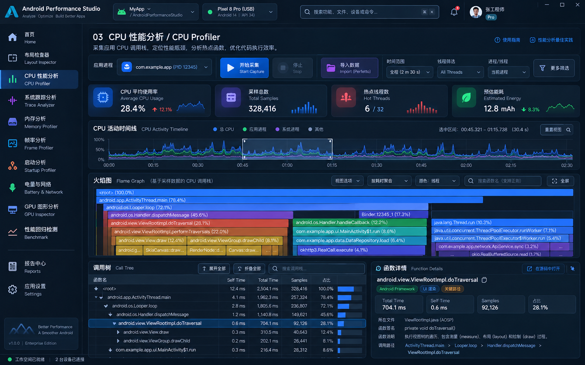

# 页面 03：CPU Profiler



## 8.1 当前支撑能力

现有 CPU/Simpleperf 已具备：

```text
Device/target selection
Capture
Offline import
SQLite projection
Overview
Top Functions
Call Tree
Flame Graph
Stack Chart
Marker Chart
Marker Table
Diagnostics
Firefox Profiler integration
Export
AI Analysis
Source correlation
```

商业化重点是重新组织 workspace，而不是重做 FlameGraph。

## 8.2 目标布局

```text
Toolbar
Device | App | Process | Thread | Capture | Import | Search | Filter

KPI
Samples | Threads | Capture Duration | Effective Sample Rate

Activity Timeline / Sampling Overview

Main Tabs
Overview | Flame Graph | Call Tree | Top Functions | Stack | Markers

Main Analysis                                 Detail Inspector
Flame / CallTree / Table                     Selected symbol / stack
```

## 8.3 KPI 规则

允许：

- Samples；
- Thread count；
- Capture duration；
- sample/event frequency；
- lost/invalid samples（若现有 evidence 存在）；
- top function share。

禁止无数据来源时显示：

- Average CPU Usage；
- Energy Cost；
- CPU temperature。

## 8.4 Flame Graph

必须复用：

```text
FlameGraphCanvas
FlameGraphLayout
FlameGraphNavigator
FlameGraphTooltip
FlameGraphDetailsPanel
```

商业化改造只处理：

- 周边 Chrome；
- toolbar；
- breadcrumb；
- search/filter；
- details pane；
- export entry；
- theme token。

禁止重写 flame layout algorithm。

## 8.5 Call Tree / Top Functions

升级成统一 `StudioDataTable` 风格：

```text
Function
Library / Path
Total %
Inclusive
Self
Samples
Threads
```

保留：

- selection；
- sort；
- keyboard navigation；
- focus flame；
- focus call tree。

## 8.6 AI Insights

推荐由 Dialog 改为可停靠 `Insight Drawer`：

```text
Evidence Scope
Findings
Confidence
Explanation
Recommendation
Open Source
```

但 AI 结果必须继续明确模型和 evidence scope。

## 8.7 源码修改范围

```text
simpleperf-viewer/presentation/DeviceTargetPage.kt
simpleperf-viewer/presentation/ReportPage.kt
simpleperf-viewer/presentation/HomeScreen.kt
simpleperf-viewer/app-desktop/SimpleperfMainPage.kt
```

Controller / Storage / Analysis 不应因视觉改造被重写。

## 8.8 当前落地与布局说明（2026-10-20）

- 移除了 ReportWorkspace / FirefoxReportWorkspace 的页面级边框方框，报告内容直接铺在 workspace 背景上。
- 统一由 ReportWorkspace 提供 `compactContentPadding`（8dp）外边距，KPI 卡片、时间线、标签页等内容到页面边缘的距离一致，不再叠加页面级 padding 与内容区 padding 两层留白。
- DeviceTargetPage 不再额外包裹 ReportWorkspace 的外边距。

## 8.9 验收

- Flame Graph golden/UI tests 继续通过或有明确 golden 更新；
- Capture 不受页面切换影响；
- Report tab selection 保留；
- 大 call tree 滚动性能不退化；
- AI 分析仍能跳 Source Workspace；
- “CPU Usage” 等指标无真实证据时不出现。

---
