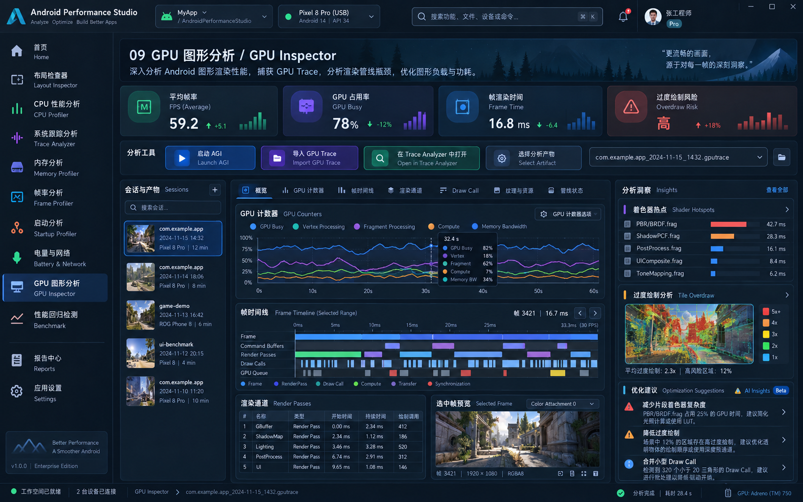

# 页面 09：GPU Analysis Hub



## 14.1 第一阶段产品定位

当前模块应命名/解释为：

> GPU Analysis Hub — Android GPU Inspector / Perfetto / GPU artifact integration center.

不是本地完整 AGI 替代品。

## 14.2 页面布局

```text
GPU Analysis

Device / Graphics Context
GPU Renderer | Driver | API | Graphics Implementation

AGI Capability
Version | Launch Mode | Executable | Warnings

Actions
Launch AGI | Import Artifact | Open Trace Analyzer

Artifacts
Kind | File | Device | Package | API | Captured | Status | Action

Related Evidence
Frame trace / Perfetto / Screenshot / External report
```

## 14.3 可真实实现的功能

当前模型已经可支撑：

- AGI executable discovery；
- version；
- launch mode；
- launch supported；
- artifact open supported；
- device graphics context；
- graphics API；
- GPU artifact kind；
- path/hash/size；
- artifact location verification；
- open/reveal/relocate；
- Open in Perfetto / AGI。

## 14.4 第一阶段禁止实现的面板

没有稳定 parser/data source 前不得实现：

```text
GPU Busy chart
Vertex / Fragment Processing
Shader Hotspots
Render Pass table
Draw Call table
Tile Overdraw
Frame Attachment preview derived from AGI frame profile
```

设计图这些区域改为：

```text
Artifact Preview / Metadata
Related Analysis
External Tool Capability
Open with AGI
```

## 14.5 后续 In-App GPU Analyzer 的独立前置条件

必须先回答：

1. AGI artifact 格式是否公开、稳定、可合法读取？
2. 是否有官方 CLI / export API？
3. Perfetto 是否已经覆盖目标 counter？
4. 是否需要 device-side agent？
5. shader/render-pass/draw-call 的来源、版本与兼容矩阵？

上述未完成前不立项内嵌 GPU Analyzer UI。

## 14.6 当前落地与布局说明（2026-10-20）

- 「分析工具」条移动到页面顶部 Header 的最前面（Launch AGI / Import GPU Trace / Open Trace Analyzer / 分析产物选择 / Show in files）。
- 状态文字和 Refresh AGI、Configure AGI 位于该行末尾，其中 Refresh AGI 在 Configure AGI 之前。
- GPU 工作区不再重复渲染分析工具条，直接从汇总卡片开始。

---
